<picture>
  <source media="(prefers-color-scheme: dark)" srcset="assets/banner-dark.svg">
  
</picture>

Oi, eu sou o Gabriel. Sou dev full-stack e gosto de cuidar do produto inteiro. No dia a dia trabalho com TypeScript (React, Next.js e Node.js) e PHP com Laravel, quase sempre com PostgreSQL por baixo.

Hoje estudo agentes de IA na prática: servidores MCP e evals que medem se o agente acerta.

### O que estou construindo

- [**Copiloto Restaurante**](https://github.com/GabrielDenardi/copiloto-restaurante): agente de IA para donos de restaurante, com servidor MCP e evals no CI
- [**Estoque API**](https://github.com/GabrielDenardi/estoque-api): API Laravel de estoque com histórico imutável e saldo auditável
- [**PetAjuda**](https://github.com/GabrielDenardi/pet-ajuda): plataforma de doações para animais em situação de rua, com Mercado Pago

### Últimos textos

<!-- blog:start -->
| Data | Texto |
| --- | --- |
| out 2026 | [Como eu montei esse blog](https://blog.gabrieldenardi.com.br/como-montei-esse-blog) |
| set 2026 | [Primeiro post (finalmente)](https://blog.gabrieldenardi.com.br/primeiro-post) |
<!-- blog:end -->

<samp>[site](https://gabrieldenardi.com.br) . [blog](https://blog.gabrieldenardi.com.br) . [linkedin](https://www.linkedin.com/in/gabrieldenardi06/) . [email](mailto:gab.denardi06@gmail.com)</samp>
